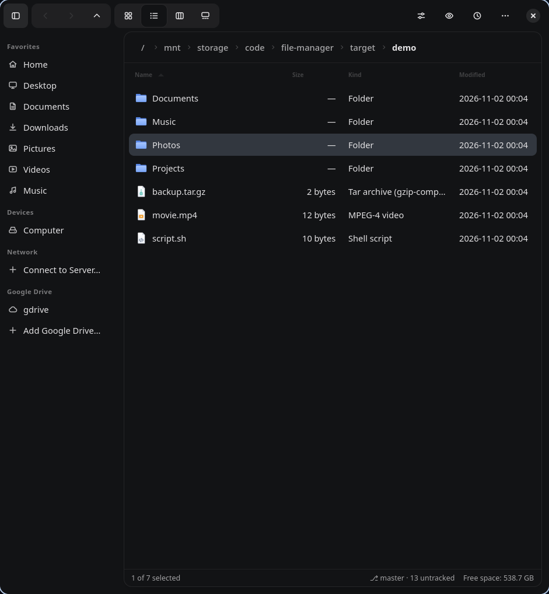
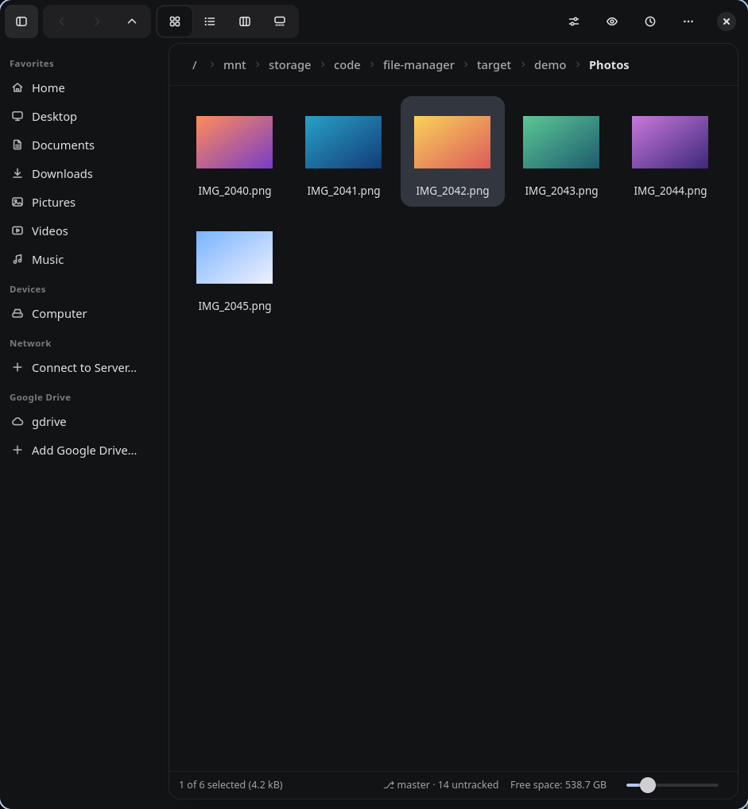
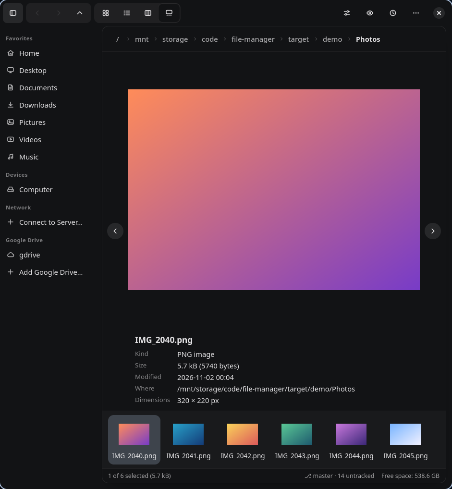
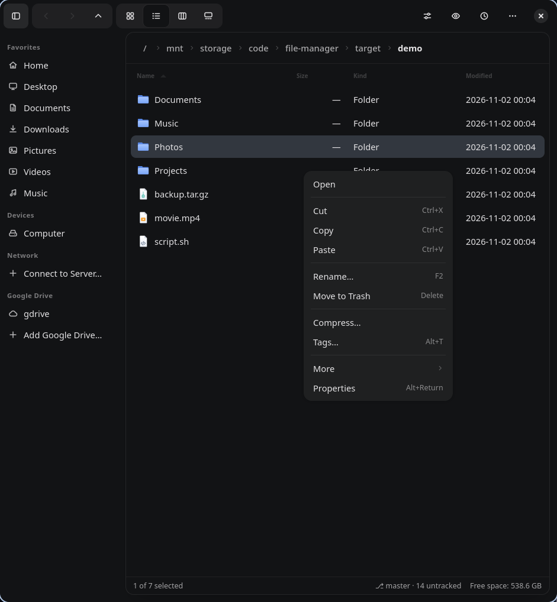
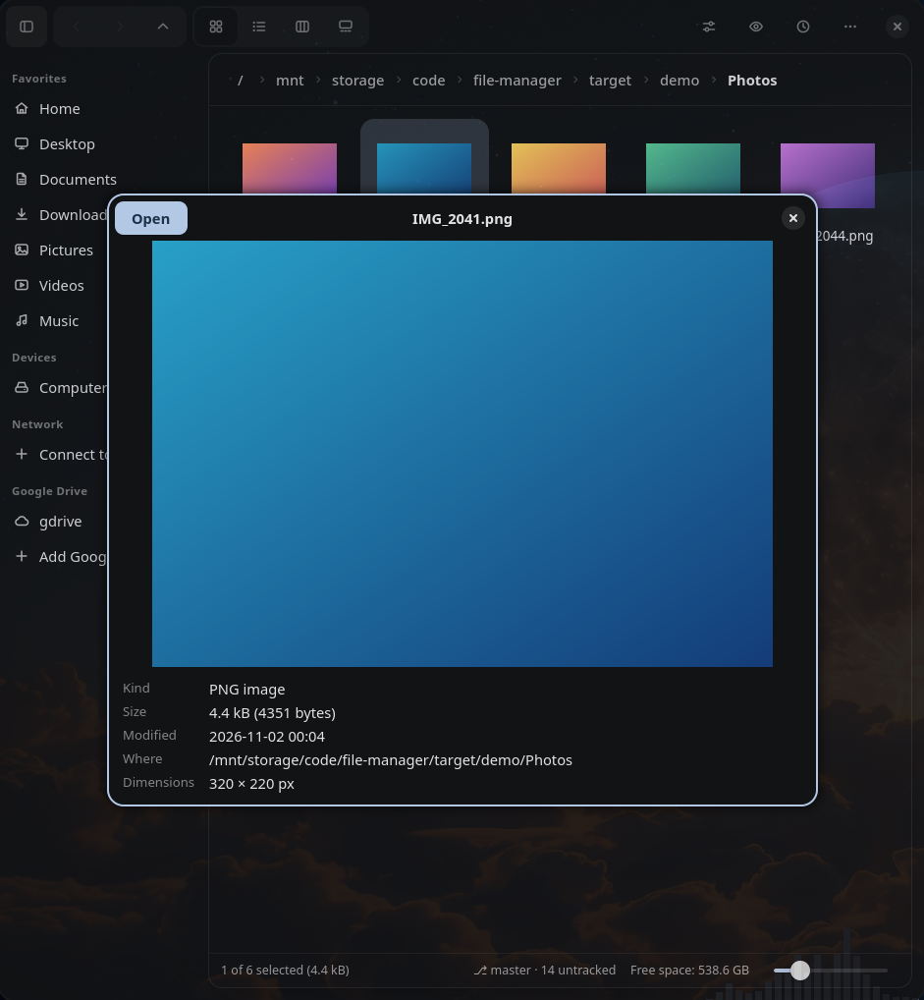
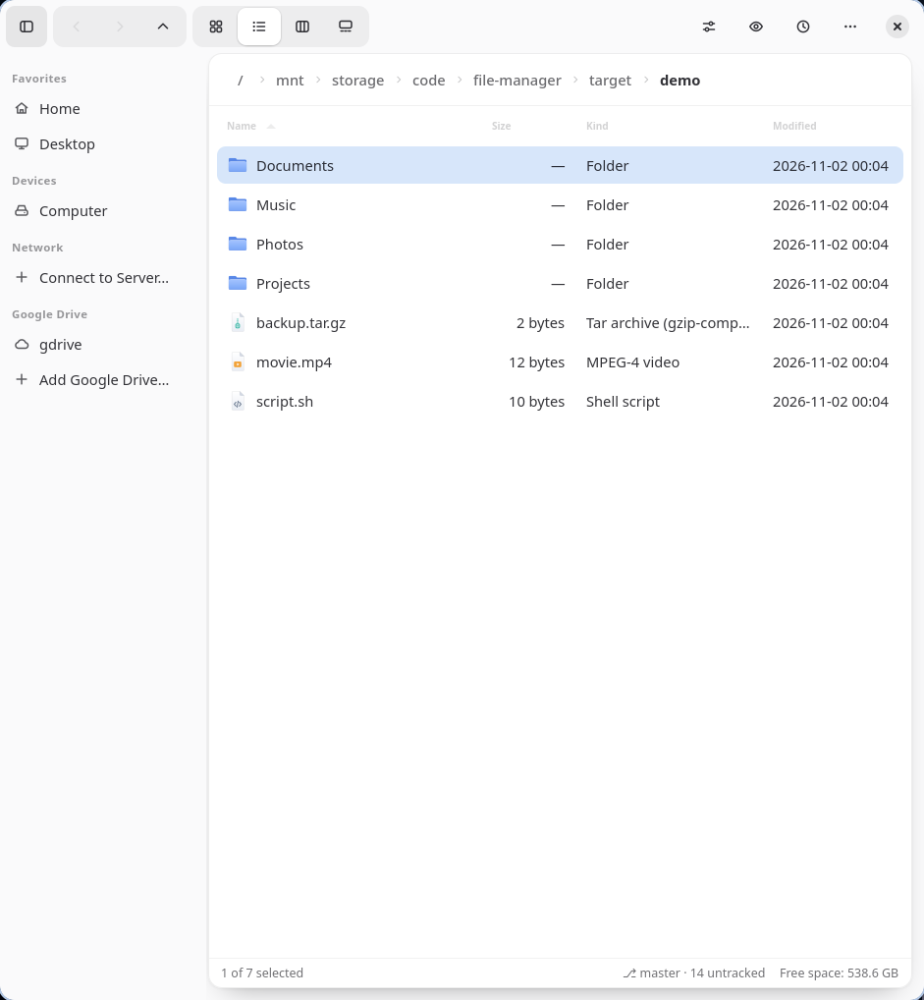

<h1 align="center">File Manager</h1>
<p align="center"><b>Design beautifully. Navigate effortlessly. Manage everything.</b></p>
<p align="center">
A fast, native file manager for Linux, written in Rust on GTK 4 and libadwaita.<br>
The calm look of Finder, the depth of Dolphin.
</p>

<p align="center"></p>

---

## Contents

- [Highlights](#highlights)
- [Install](#install)
- [Requirements](#requirements)
- [A tour of the interface](#a-tour-of-the-interface)
- [Features in detail](#features-in-detail)
- [Keyboard shortcuts](#keyboard-shortcuts)
- [Google Drive and network locations](#google-drive-and-network-locations)
- [Custom actions and plugins](#custom-actions-and-plugins)
- [Command line and desktop integration](#command-line-and-desktop-integration)
- [Settings and data](#settings-and-data)
- [Safety guarantees](#safety-guarantees)
- [Building from source](#building-from-source)
- [Architecture](#architecture)
- [Development](#development)
- [Continuous integration and releases](#continuous-integration-and-releases)
- [Status against the specification](#status-against-the-specification)
- [Troubleshooting](#troubleshooting)
- [License](#license)

## Highlights

- **Four views** – icons, list, columns and a gallery – with background thumbnails that never block the window.
- **Tabs and split view**, bookmarks, tags, recent places, and a session that is restored on the next start.
- **Quick Look** (<kbd>Space</kbd>): a floating preview for images, text, Markdown, source, audio and video.
- **Dependable file operations** on worker threads: progress, pause, cancel, retry, conflict resolution, notifications and **undo**.
- **Built-in power tools**: archives, search, duplicate finder, file compare, batch rename, checksums, a permissions editor and disk usage.
- **Git** badges and actions, **Google Drive**, **network** shares, removable drives.
- **Extensible**: custom actions and declarative plugins; every shortcut can be rebound.
- A **custom icon family**, light and dark themes, restrained animation, and a layout that adapts to narrow windows.

| Icons | Gallery |
|---|---|
|  |  |

| Context menu | Quick Look |
|---|---|
|  |  |



## Install

Every release on the [Releases page](../../releases) contains these files, plus `SHA256SUMS`:

| Format | File | Install |
|---|---|---|
| Debian / Ubuntu | `file-manager_<version>_amd64.deb`, `…_arm64.deb` | `sudo apt install ./file-manager_<version>_amd64.deb` |
| Arch / CachyOS / Manjaro | `file-manager-<version>-1-x86_64.pkg.tar.zst` | `sudo pacman -U file-manager-<version>-1-x86_64.pkg.tar.zst` |
| Fedora | `file-manager-<version>-1.<dist>.x86_64.rpm` | `sudo dnf install ./file-manager-<version>-1.*.x86_64.rpm` |
| AppImage | `file-manager-<version>-x86_64.AppImage` (and `aarch64`) | `chmod +x file-manager-*.AppImage && ./file-manager-*.AppImage` |
| Linux binary | `file-manager-<version>-x86_64-linux.tar.gz` (and `aarch64`) | extract, then `./install.sh` (user install) or `sudo ./install.sh --prefix /usr/local` |

Verify a download with `sha256sum -c SHA256SUMS --ignore-missing`. Release files also carry a
[build provenance attestation](https://docs.github.com/actions/security-guides/using-artifact-attestations-to-establish-provenance-for-builds):
`gh attestation verify <file> --repo <owner>/file-manager`.

Notes:

- **Debian packages** need Debian 13 / Ubuntu 24.04 or newer (GTK 4.12, libadwaita 1.5).
- **The AppImage** bundles GTK, libadwaita and `bsdtar`, and needs glibc 2.39 or newer (it is built on Ubuntu 24.04).
- **The Fedora package** is built on current Fedora. Fedora 40 or newer is expected to work.
- **The tarball** is a dynamically linked binary and needs the GTK 4 and libadwaita libraries from [Requirements](#requirements).
- To remove a tarball install: `./install.sh --uninstall` (with the same `--prefix`).

## Requirements

**Runtime (required)**

| Library | Minimum |
|---|---|
| GTK 4 | 4.12 |
| libadwaita | 1.5 |
| SQLite 3 | any |
| `bsdtar` (libarchive) | any – used for every archive operation |
| shared-mime-info | any |

**Optional, enables features**

| Tool | Enables |
|---|---|
| `git` | repository status, badges and Git actions |
| `gvfs` (+ its FUSE daemon, `gvfs-fuse`) | network locations, mounting drives with a password prompt |
| `rclone` and `fuse3` | Google Drive |
| `poppler-utils` (`pdfinfo`) | PDF details in Properties |
| `ffmpeg` (`ffprobe`) | video details in Properties |
| GStreamer plug-ins (`gst-plugins-good`, …) and GTK's GStreamer media backend | audio and video playback in Quick Look |

The same list as package names:

```sh
# Debian / Ubuntu
sudo apt install libgtk-4-1 libadwaita-1-0 libarchive-tools shared-mime-info git gvfs gvfs-fuse rclone fuse3 poppler-utils ffmpeg
# Arch
sudo pacman -S gtk4 libadwaita sqlite libarchive shared-mime-info git gvfs rclone fuse3 poppler ffmpeg gst-plugins-good
# Fedora
sudo dnf install gtk4 libadwaita sqlite-libs bsdtar shared-mime-info git gvfs gvfs-fuse rclone fuse3 poppler-utils
```

## A tour of the interface

```text
┌──────────────────────────────────────────────────────────────────────┐
│ [▢] ‹ › ˄   ▦ ☰ ▥ ▭                          ⚙   👁   🕘   ⋯   ✕   │  header
├────────────┬─────────────────────────────────────────────────────────┤
│ Favorites  │  tab ─ tab                                              │  tab bar (when 2+ tabs)
│  Home      │ ╭─────────────────────────────────────────────────────╮ │
│  Desktop   │ │ / mnt › storage › projects ›  demo                  │ │  breadcrumb
│ Bookmarks  │ ├─────────────────────────────────────────────────────┤ │
│ Devices    │ │                                                     │ │
│ Network    │ │   files and folders                                 │ │  the "sheet"
│ Google …   │ │                                                     │ │
│ Tags       │ ├─────────────────────────────────────────────────────┤ │
│            │ │ 3 of 12 selected      ⎇ main · 2 changed   7 GB free│ │  status bar
│            │ ╰─────────────────────────────────────────────────────╯ │
└────────────┴─────────────────────────────────────────────────────────┘
```

- **Header** – sidebar toggle · back / forward / up · view switcher (icons, list, columns, gallery) ·
  filter box · **View options** (sort order, hidden files) · Quick Look · recent places · operations
  (appears while something is running) · main menu.
- **Sidebar** – places, bookmarks, drives, servers, Google Drive and tags. Drop files on an entry to copy or move them there.
- **Sheet** – the browsing area. Each tab holds one pane, or two when split.
- **Status bar** – item count or selection summary, Git branch and state when inside a repository, and free space.

The header controls adapt to the window width: the filter box hides first, then the recent-places button and sidebar
(which becomes an overlay), then the view switcher.

## Features in detail

### Browsing

- **Icon view** – thumbnails for images (decoded off the main thread, at most four at a time, cached in memory);
  freedesktop thumbnails are used for other types when they exist. A slider in the status bar sets the icon size (48–256 px).
- **List view** – Name, Size, Kind and Modified columns; click a header to sort; columns can be resized.
- **Column view** – Finder-style hierarchical columns. Selecting a folder opens the next column; selecting a file shows a preview card.
- **Gallery view** – a large preview, previous/next buttons (also <kbd>←</kbd>/<kbd>→</kbd>), a thumbnail strip and file details.
- **Sorting** – by name, size, kind or date modified, ascending or descending; folders always come first.
- **Filtering** – <kbd>Ctrl</kbd>+<kbd>F</kbd> filters the current folder as you type.
- **Hidden files** – toggle in *View options* or with <kbd>Ctrl</kbd>+<kbd>H</kbd>; the choice is remembered.
- **Symbolic links** – a link to a folder behaves as a folder (with a small link badge); broken links still appear.
- **Live updates** – the folder watches the filesystem; created, renamed and deleted files appear without a refresh
  (bursts of more than 200 changes trigger a full reload). Huge folders load incrementally.
- **Large folders** – directories are enumerated asynchronously in batches, and lists are virtualised.

### Navigation

- **Breadcrumbs** – click any part of the path. <kbd>Ctrl</kbd>+<kbd>L</kbd> switches to an editable path (<kbd>Esc</kbd> cancels).
- **History** – back, forward and up, with <kbd>Alt</kbd>+arrows and the **mouse side buttons**.
- **Animated arrival** – opening a folder slides its contents in from the right; going back or up slides from the left.
- **Recent** – the clock button lists recent folders and recently opened files.
- **Tabs** – open, close, reorder by dragging, duplicate (tab menu), and reopen the last closed tab. The tab bar appears
  only when there are two or more tabs. Open tabs are restored on the next start, along with the window size.
- **Split view** – <kbd>F3</kbd> shows two independent panes in one tab. Each pane has its own history, view mode, sort and filter.
  The active pane carries an accent underline and the header controls follow it.
- **Several windows** – <kbd>Ctrl</kbd>+<kbd>N</kbd>.
- **Bookmarks** – <kbd>Ctrl</kbd>+<kbd>D</kbd> or *Bookmark This Folder*. Right-click a bookmark to rename or remove it; drag to reorder.
- **Open from elsewhere** – `file-manager <folder>` opens tabs, and `file-manager <file>` opens its folder with the file selected.

### File operations

All expensive work runs on background threads. The window never freezes.

- **Copy, cut, paste** – through the system clipboard, in the formats Nautilus and Dolphin use, so you can copy in one app and paste in another.
- **Drag and drop** – onto folders, onto empty space (current folder) and onto sidebar entries. Within one filesystem a drop **moves**; across
  filesystems it **copies**. Hold <kbd>Ctrl</kbd> to force a copy. Dragging an unselected item drags only that item and leaves your selection alone.
- **Trash and delete** – <kbd>Delete</kbd> moves to the Trash; <kbd>Shift</kbd>+<kbd>Delete</kbd> deletes permanently after a confirmation.
- **Rename** – <kbd>F2</kbd>. Renaming onto an existing name is refused.
- **Batch rename** – select several items and press <kbd>F2</kbd>: find and replace (optionally regular expressions, ignoring case),
  prefix, suffix, sequential numbering (`Trip {n}`, start, step, digits) and case change, with a live preview. Duplicate or already-existing
  names disable the button. Renames go through temporary names, so swaps and cycles work and nothing is overwritten; a failure rolls everything back.
- **New folder / new file** – <kbd>Ctrl</kbd>+<kbd>Shift</kbd>+<kbd>N</kbd> and the empty-space menu.
- **Conflicts** – when a destination exists you can *Replace*, *Skip*, *Keep Both*, *Replace All*, *Skip All* or *Compare*
  (sizes, dates and which is newer). Folders merge; a folder can never replace a file or vice versa.
- **Progress** – the operations button shows every running job with progress, the current file, **pause/resume** and **cancel**.
  Failed operations stay listed with their errors and a **Retry** button that re-runs only what did not finish.
- **Notifications** – an operation that takes more than five seconds sends a desktop notification if the window is in the background.
- **Undo** – <kbd>Ctrl</kbd>+<kbd>Z</kbd> reverses rename, batch rename, new folder/file, copy (the copies go to the Trash), move and move-to-Trash.
  An operation that replaced or merged into existing data clears the undo list rather than risk reversing the wrong thing. Permanent
  deletion cannot be undone.

### Quick Look

Press <kbd>Space</kbd> on a selection for a floating preview window. <kbd>Space</kbd> or <kbd>Esc</kbd> closes it, the arrow keys move the
selection underneath while it stays open, and <kbd>Enter</kbd> opens the file.

| Type | Preview |
|---|---|
| Images | decoded off-thread (up to 2048 px), with dimensions and EXIF (camera, lens, exposure, ISO, GPS) |
| Text, source code, config | first 64 KB in monospace |
| Markdown | headings, bullets, code blocks, `code` and **bold** |
| Audio and video | plays automatically with controls; playback stops the moment the window closes or you move on |
| Folders | number of items |
| Documents, PDFs | the system thumbnail when one exists, plus details |
| Audio files | title, artist, album, genre, year, track, duration, bitrate, sample rate, channels |

Previews are asynchronous and cancelled when you change the selection. Audio and video need GTK's GStreamer media backend; if
playback is unavailable you get a message instead of silence.

### Archives

Powered by libarchive's `bsdtar`: zip, tar, tar.gz, tar.xz, tar.zst, tar.bz2, 7z and rar (read).

- **Enter or double-click** on a common archive **extracts it**. `.jar`, `.apk`, `.iso` and `.cab` still open normally.
- **Extract Here / Extract To…** – never overwrites. A single top-level entry that does not exist yet is extracted in place;
  anything else goes into a new folder named after the archive (`name`, `name 2`, …). With *Extract To…* the same rule applies inside the folder you pick.
- **Browse Contents…** lists the archive with sizes before you extract.
- **Compress…** – choose the name, format (zip, tar, tar.gz, tar.xz, tar.zst, 7z) and level (fast, normal, smallest). The archive is written to a
  `.part` file and renamed when done; an existing archive is never replaced.
- **Passwords** – encrypted archives prompt for a passphrase. The passphrase is handed to `bsdtar` on its command line, so other processes of the
  same user can briefly see it. Creating password-protected archives is not offered.
- libarchive's defaults reject `..` paths and unsafe symlinks.

### Search, duplicates and compare

- **Search** (<kbd>Ctrl</kbd>+<kbd>Shift</kbd>+<kbd>F</kbd>) – a window with name (substring, or glob with `*` and `?`), text inside files,
  type (folders, images, audio, video, documents, text and code, archives), extensions, size, modified date, subfolders and hidden files.
  Results stream in as they are found, with a snippet and line number for content matches, and stop at 5 000. *Show in Folder* jumps to the result.
  Search history is kept. Binary files and files over 10 MB are skipped for content search; cloud drives are never content-scanned.
- **Duplicate finder** – groups files by size, then a quick hash, then a full SHA-256, so only truly identical files are reported. Hard links to
  one file are not duplicates. *Select Extras* keeps the first copy of each group; selected files go to the Trash (undoable), and the dialog refuses
  to select every copy of a file.
- **Compare** – with two files selected: sizes and dates, an *identical* verdict, a line diff with context for text, and the first differing byte for binaries.

### Properties, checksums and permissions

*Properties* (<kbd>Alt</kbd>+<kbd>Enter</kbd>) works on one item, many items, or the current folder.

- **General** – name, kind, location, link target, size (folders are measured in the background, hard links counted once), times, owner, group and mode.
- **Details** – photo EXIF, audio tags, PDF info (`pdfinfo`), video info (`ffprobe`), and anything an enabled [plugin](#custom-actions-and-plugins) provides.
- **Checksums** – MD5, SHA-1, SHA-256 or SHA-512, streamed so large files never load into memory; cancellable.
- **Permissions** – read/write/execute for owner, group and others, setuid, setgid and sticky bits, and a group picker limited to groups you belong to.
  *Apply to* chooses this item only, everything inside, folders only, or files only. Symlinks are never followed.
  The app **never escalates privileges**: changing the owner is not offered, and refused changes show the system's error.

### Tags

<kbd>Alt</kbd>+<kbd>T</kbd> edits tags on the selection (mixed state is shown when only some items carry a tag). Tags appear as coloured dots beside names,
every tag has a sidebar entry, and clicking it lists everything carrying it. Tags are stored in the app's database and follow files you rename or
move inside the app (not changes made by other programs).

### Git

When a folder is inside a repository (detected without running `git` elsewhere):

- **Badges** – Modified, Added, Renamed, Deleted, Untracked and Conflict beside names. Folders show the most important state inside them; ignored
  files are not badged. Everything inside an untracked folder inherits its state.
- **Status bar** – `⎇ branch ↑ahead ↓behind · N changed · N untracked`.
- **Context menu → Git** – Stage, Unstage, Discard Changes (asks first, never touches untracked files), Commit, Pull (fast-forward only), Push, Refresh.
- Network operations never prompt for passwords; they fail with git's message. Turn it all off with *Show Git Status* in the main menu.

### Storage and drives

- **Sidebar → Devices** lists mounted drives (with eject/unmount buttons) and mounts unmounted volumes when clicked. It updates the moment a drive appears.
- **Storage & Disk Usage** (main menu) – *Drives*: capacity bars (amber and red as a drive fills), filesystem type, device, UUID, mount point, read-only and
  removable flags. *Folder Usage*: the size of every item in a folder, filling in as it is measured; click a folder to drill down.
- The status bar always shows free space for the current folder.

### Terminal, Open With and paths

- <kbd>F4</kbd> opens a terminal in the current folder (or the selected one). The emulator comes from the `terminal` preference, then `$TERMINAL`, then
  a list of common emulators (xdg-terminal-exec, kitty, alacritty, foot, wezterm, ghostty, gnome-terminal, konsole, xfce4-terminal, tilix, kgx, xterm).
- *Open With…* lets you choose the application. <kbd>Ctrl</kbd>+<kbd>Shift</kbd>+<kbd>C</kbd> copies the path.

### Appearance

- **Themes** – follow the system, or force light or dark from *Appearance* in the main menu. The accent colour comes from the system.
- **Icons** – a consistent family (toolbar glyphs, places, and file/folder icons by type) that looks the same under any icon theme.
- **Motion** – folder arrival, a single rise when the window opens, press feedback and soft hover and selection fades. GTK's "enable animations" setting is respected.
- **Responsive** – the layout reflows from wide windows down to 360 px.
- If your desktop applies its own `~/.config/gtk-4.0/gtk.css` colours, they take precedence over the light/dark choice.

## Keyboard shortcuts

Every shortcut can be changed: main menu → **Keyboard Shortcuts**. Click an entry, press the new keys; <kbd>Backspace</kbd> disables it,
<kbd>Esc</kbd> cancels. Picking a combination that is already used takes it from the other action. Bare keys such as <kbd>Space</kbd> never
trigger while you are typing in a text box.

| Action | Default shortcut |
|---|---|
| Undo | `Ctrl+Z` |
| Edit tags | `Alt+T` |
| Compare two files | — |
| Find duplicate files | — |
| New window | `Ctrl+N` |
| New tab | `Ctrl+T` |
| Close tab | `Ctrl+W` |
| Reopen closed tab | `Ctrl+Shift+T` |
| Duplicate tab | — |
| Next tab | `Ctrl+Page Down` |
| Previous tab | `Ctrl+Page Up` |
| Toggle split view | `F3` |
| Focus location entry | `Ctrl+L` |
| Filter / search | `Ctrl+F` |
| Toggle hidden files | `Ctrl+H` |
| Select all | `Ctrl+A` |
| Copy | `Ctrl+C` |
| Cut | `Ctrl+X` |
| Paste | `Ctrl+V` |
| New folder | `Ctrl+Shift+N` |
| New file | — |
| Rename | `F2` |
| Move to trash | `Delete` |
| Delete permanently | `Shift+Delete` |
| Back | `Alt+←` |
| Forward | `Alt+→` |
| Parent directory | `Alt+↑` |
| Refresh | `F5` |
| Grid view | `Ctrl+1` |
| List view | `Ctrl+2` |
| Column view | `Ctrl+3` |
| Gallery view | `Ctrl+4` |
| Quick preview panel | `Space` |
| Toggle sidebar | `F9` |
| Connect to server | `Ctrl+K` |
| Storage and disk usage | — |
| Bookmark this folder | `Ctrl+D` |
| Properties | `Alt+Enter` |
| Search files | `Ctrl+Shift+F` |
| Compress to archive | — |
| Extract archive here | — |
| Extract archive to… | — |
| Browse archive contents | — |
| Open terminal here | `F4` |
| Copy path | `Ctrl+Shift+C` |

Fixed keys: <kbd>Enter</kbd> opens (folders navigate, archives extract); in Quick Look, <kbd>Space</kbd>/<kbd>Esc</kbd> close,
arrows move, <kbd>Enter</kbd> opens; in the gallery <kbd>←</kbd>/<kbd>→</kbd> step.

## Google Drive and network locations

### Google Drive

Drive appears as an ordinary folder, so browsing, copy and paste, drag and drop, preview and archives all work on it.

1. Install `rclone` and `fuse3`.
2. In the sidebar choose **Add Google Drive…**, name the account and pick *Full access* or *Read-only*. Your browser opens so you can sign in to Google.
3. Click the account in the sidebar. It is mounted under `~/.local/share/file-manager/cloud/<name>` and opened. Use the eject button to disconnect and
   **Remove Account…** to delete the saved token (your files on Drive are untouched).

Your Google password is never seen by this app; `rclone` performs the OAuth sign-in and keeps the token in its own config (`~/.config/rclone/rclone.conf`).
Thumbnails and content search skip the Drive folder so browsing never downloads your whole drive. On GNOME with an online account you can instead use
`google-drive://you@gmail.com/` in *Connect to Server*.

### Network locations

**Connect to Server…** (<kbd>Ctrl</kbd>+<kbd>K</kbd>) accepts `sftp://`, `smb://`, `ftp://`, `dav://`, `davs://` and `nfs://` addresses (and `ssh://` as an alias for SFTP).
Password and host-key prompts are shown by GTK. *Remember this server* adds it to the sidebar for one-click reconnects. Servers are mounted by GVfs and browsed
through its FUSE path, so every view and file operation – including copying between local and remote – works unchanged. This requires `gvfs` and `gvfs-fuse`.

## Custom actions and plugins

Open the main menu → **Custom Actions & Plugins…**.

### Custom actions

Add commands that appear under **More → Actions** in the context menu for matching files:

- **Command** – an argument list written with shell-style quoting (`code --goto "%f"`). It is **not** run through a shell, so odd file names cannot inject commands.
- **Applies to** – `any`, `files`, `folders`, patterns such as `*.png`, or MIME types such as `image/*` (comma separated). Every selected item must match.
- **Wait for it to finish** – shows a progress row and reports the result; otherwise the program is simply started.

Placeholders: `%f` first path · `%F` all paths (as separate arguments) · `%d` current folder · `%n` file name · `%b` name without extension · `%u` URI · `%%` a percent sign.

### Plugins

A plugin is a folder containing `plugin.toml`, placed in `~/.local/share/file-manager/plugins/` (or `/usr/share/file-manager/plugins/`).
**New plugins start switched off** – read what they run, then enable them in the manager. Plugins are declarative: nothing executes when one is loaded.

```toml
id = "image-tools"            # letters, digits, - _ .
name = "Image Tools"
version = "1.0"
description = "Small helpers for pictures"

[[actions]]                   # context-menu actions
id = "half"
name = "Resize to 50%"
command = ["convert", "%f", "-resize", "50%", "%d/%b-small.png"]
mime = ["image/*"]            # and/or extensions = ["png"], folders = true, files = true
wait = true                   # show progress and report the result

[[metadata]]                  # extra rows in Properties → Details
title = "ImageMagick"
command = ["identify", "-verbose", "%f"]     # prints "Key: Value" (or key=value) lines
mime = ["image/*"]
```

Limits: manifests up to 64 KB, 50 actions per plugin, metadata commands time out after 10 seconds. Plugins that fail to load are listed with the reason.

## Command line and desktop integration

```sh
file-manager                     # restore the last session
file-manager ~/Pictures ~/Music  # open folders in new tabs
file-manager ~/Pictures/a.png    # open the folder with the file selected
```

- **Desktop entry** – registered for `inode/directory`; the launcher has a *New Window* action.
- **D-Bus** – if no other file manager owns `org.freedesktop.FileManager1`, the app answers `ShowFolders`, `ShowItems` and `ShowItemProperties`, so
  "show in folder" in browsers and chat apps opens it. It never takes the name from a running file manager.
- **Freedesktop** – Trash specification, XDG user directories, thumbnails, MIME associations, desktop notifications, and clipboard formats shared with GNOME and KDE.
- **Wayland and X11** – both work; there is no compositor-specific code.

## Settings and data

| What | Where |
|---|---|
| Database (bookmarks, recents, tabs, tags, preferences, window size, saved servers, custom actions, search history) | `~/.local/share/file-manager/fm.sqlite` |
| Plugins | `~/.local/share/file-manager/plugins/` |
| Google Drive mounts | `~/.local/share/file-manager/cloud/` |
| Unpacked icons | `~/.cache/file-manager/icons-<hash>/` |
| Trash | the standard freedesktop trash directories |

Preferences live in the `user_preferences` table (`default_view`, `show_hidden`, `color_scheme`, `terminal`, `git_off`, `plugin.<id>.enabled`,
`shortcut.<action>`). There is no preferences window beyond the shortcut editor and plugin manager; to change the terminal, for example:

```sh
sqlite3 ~/.local/share/file-manager/fm.sqlite "insert or replace into user_preferences values ('terminal','kitty');"
```

## Safety guarantees

- Existing files are **never overwritten silently**; replacing needs an explicit choice and goes through GIO's atomic replace.
- A move that falls back to copy-and-delete deletes the source **only if every item was copied**.
- Copying a folder into itself is refused; symlinks are copied as links; the operation stops if the disk fills up.
- Extraction, rename and compress never overwrite; duplicate removal sends files to the Trash and keeps at least one copy.
- Permission changes never follow symlinks and the app never raises its own privileges.
- Commands from custom actions and plugins are argument lists, never shell strings, and plugins are off until enabled.
- Undo only reverses what it can prove is safe, and refuses to overwrite anything when doing so.

## Building from source

```sh
# Debian / Ubuntu
sudo apt install build-essential pkg-config libgtk-4-dev libadwaita-1-dev libsqlite3-dev libarchive-tools git
# Arch
sudo pacman -S base-devel gtk4 libadwaita sqlite libarchive git
# Fedora
sudo dnf install gcc make pkgconf-pkg-config gtk4-devel libadwaita-devel sqlite-devel bsdtar git

# Rust 1.88 or newer (edition 2024): https://rustup.rs
cargo run --release
```

Install system-wide (binary, desktop entry, AppStream metadata, icons):

```sh
make
sudo make install PREFIX=/usr          # DESTDIR is honoured for packaging
sudo make uninstall PREFIX=/usr
```

## Architecture

```text
src/
├── main.rs
├── application/    app lifecycle, action registry, shared state, embedded resources
├── core/           UI-independent logic (GIO, std only)
│   ├── filesystem/     async directory loading, icons by type, human sizes
│   ├── navigation/     history
│   ├── operations/     copy/move/trash/delete engine, rename, trash lookup, undo
│   ├── search/  duplicates/  compare/  permissions/  metadata/
├── services/       archive (bsdtar), thumbnails, mounts, storage info
├── integrations/   git, network (GVfs), cloud (rclone), terminal, plugins
├── database/       SQLite schema, migrations, repository
├── settings/       preferences and their persistence
└── ui/             GTK widgets: window, pane, tabs, sidebar, views, dialogs, menus
```

Guiding rules:

- The **UI never does expensive work**; it talks to the engine through channels and applies results on the main thread.
- **`core` does not know about widgets.** It is the part covered by tests.
- **GIO / GFile** is the filesystem abstraction (local, remote, trash, mounts). `std::fs` is used where direct local access is simpler.
- Each file operation is a worker thread that streams `Progress`, `Conflict` and `Finished` events back over an async channel and blocks on conflict answers.
- SQLite stores application metadata only; file metadata always comes from the filesystem.
- Context menus are rendered as plain popovers from a `gio::Menu` model because GTK's `PopoverMenu` caps its height and scrolls.
- Icons are compiled into the binary and unpacked on first run, so a bare binary or AppImage looks right.

## Development

```sh
cargo test                                   # unit tests (needs git and bsdtar for a few)
cargo fmt --check
cargo clippy --all-targets -- -D warnings
```

The test suite covers the file-operation engine (conflicts, no-overwrite, merges, moves, summaries), undo and trash restore, rename planning,
search, duplicates, compare, permissions, checksums, archives (all formats round-trip), Git parsing against real repositories, plugin loading,
the database, metadata extractors and icon extraction.

Debug builds understand a few environment variables for taking screenshots: `FM_SELECT=<name>` selects an item, `FM_MENU=item|bg` opens a
context menu, `FM_MENU_CLICK=<label>` presses an entry in it, and `FM_QUICKLOOK=1` opens Quick Look.

**Icons** are generated by `tools/gen_icons.py` (needs `pip install shapely svgpathtools numpy`). GTK recolours symbolic icons by forcing a fill and
ignores strokes, so the script converts every stroke into a filled outline. The generated SVGs are committed.

**Versioning**: `tools/bump-version.sh X.Y.Z` updates `Cargo.toml`, the PKGBUILD, the RPM spec, the AppStream release list and the changelog;
`tools/check-version.sh` verifies they agree (CI runs it, and on tags also checks the tag).

## Continuous integration and releases

All workflows live in `.github/workflows/`.

### `ci.yml` – on every push and pull request

| Job | What it does |
|---|---|
| **lint** | `cargo fmt --check` and `cargo clippy -D warnings` |
| **test** | build and run the test suite on Ubuntu 24.04 |
| **distros** | build and test inside Fedora and Arch containers (newer GTK and libadwaita than Ubuntu) |
| **metadata** | validate the desktop entry and AppStream file, check version consistency, syntax-check the shell scripts |
| **audit** | `cargo audit` against the RustSec database (advisory) |

Dependabot keeps Cargo dependencies and GitHub Actions up to date.

### `release.yml` – on a tag `v*` (or run manually for a dry run)

| Job | Runner | Output |
|---|---|---|
| `binary` | Ubuntu 24.04 (x86_64) and 24.04-arm (aarch64) | `file-manager-<v>-<arch>-linux.tar.gz` |
| `deb` | same | `file-manager_<v>-1_<amd64|arm64>.deb` via `cargo-deb` |
| `appimage` | same | `file-manager-<v>-<arch>.AppImage` via linuxdeploy and its GTK plug-in |
| `arch` | `archlinux` container | `file-manager-<v>-1-x86_64.pkg.tar.zst` via `makepkg` |
| `fedora` | `fedora` container | `file-manager-<v>-1.<dist>.x86_64.rpm` via `rpmbuild` |
| `release` | — | collects everything, writes `SHA256SUMS`, attests provenance, publishes the GitHub release with the changelog section as its notes |

A manual run (*Actions → Release → Run workflow*) builds every artifact and uploads them to the run, but does not publish.

### Cutting a release

```sh
tools/bump-version.sh 0.2.0        # edits the version everywhere, adds a changelog stub
$EDITOR CHANGELOG.md               # write the release notes
tools/check-version.sh             # must pass
git commit -am "Release 0.2.0"
git tag v0.2.0 && git push --follow-tags
```

### One-time setup

- Replace the placeholder repository URL (`https://github.com/OWNER/file-manager`) with `tools/set-repo-url.sh https://github.com/you/file-manager`.
- Pick and add a `LICENSE` file; the packaging metadata currently says `GPL-3.0-or-later` as a placeholder.
- Set the maintainer contact in `Cargo.toml`, the PKGBUILD and the spec.
- Enable *Settings → Actions → General → Workflow permissions → Read and write*, which the release job needs.
- To publish to the AUR, copy `packaging/arch/PKGBUILD` and point `source` at the release tarball.

## Status against the specification

Implemented: the whole of phases 1–7 of `SPEC.md` except the items below.

| Not implemented yet | Notes |
|---|---|
| GSettings | preferences are stored in SQLite instead, which works without installing a schema |
| Embedded terminal panel | an external terminal is launched; there is no UI to choose the emulator |
| Video thumbnails (GStreamer) and PDF page previews | existing system thumbnails are used when present |
| Archive previews in Quick Look | use *Browse Contents…* |
| List columns for created date, permissions, owner and group; configurable columns; expandable folder sizes | shown in Properties instead |
| Selecting by pattern, extension or type; invert selection | |
| Column-view sort order, column widths and context menu | |
| Persistent operation history | the undo list is in memory (the `operation_history` table is not created) |
| Saved searches beyond the history of queries | |
| Desktop-environment-specific theming | the app follows libadwaita |

## Troubleshooting

- **Icons look wrong or missing** – delete `~/.cache/file-manager/icons-*`; they are unpacked again on the next start.
- **Light theme does nothing** – a `~/.config/gtk-4.0/gtk.css` (or theming tool) that defines window colours overrides the choice.
- **Network folders are empty or will not mount** – install `gvfs` and `gvfs-fuse`, and make sure `gvfsd-fuse` is running.
- **Google Drive: "rclone is needed"** – install `rclone` and `fuse3`; if mounting fails, check that `fusermount3` is installed.
- **Audio or video does not play in Quick Look** – install GStreamer plug-ins (`gst-plugins-good`, `gst-libav`) and GTK's GStreamer media module (`gtk4-media-gstreamer` or distro equivalent).
- **Archive operations fail** – install `bsdtar` (`libarchive-tools` on Debian, `libarchive` on Arch).
- **Mouse back/forward buttons do nothing** – they must reach the app as buttons 8 and 9; check your compositor or mouse-remapping tool.
- **Run with logging**: `RUST_LOG=debug file-manager`.

## License

The project's license has not been chosen yet. Packaging metadata uses `GPL-3.0-or-later` as a **placeholder**; add a `LICENSE` file and update
`Cargo.toml`, `data/dev.filemanager.FileManager.metainfo.xml`, the PKGBUILD and the RPM spec before publishing a release.
